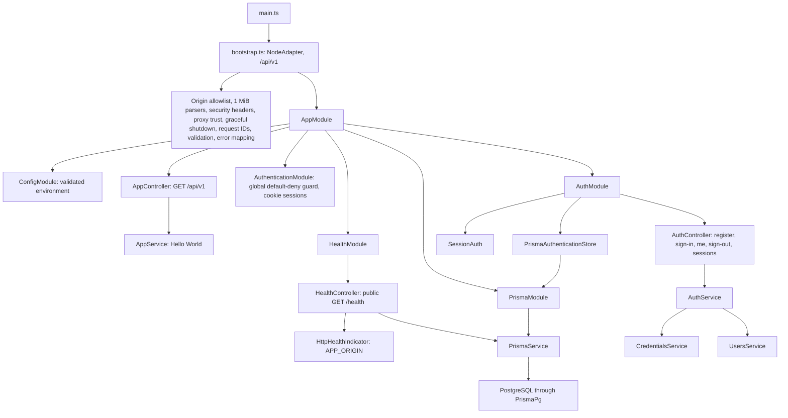

# API and module intelligence

As of 29 October 2026. Paths below are relative to `apps/api`. Current and target maps are separate. This file is a navigation aid; inspect owning source before edits.

## Current runtime map

The library's `@Public()` opt-out leaves registration, sign-in, sign-out, root hello, and health public; all other routes require a registered credential provider. Session state persists through Prisma. Registration and sign-in use a shared PostgreSQL fixed-window limiter with HMAC-keyed identities; production startup requires a shared `AUTH_RATE_LIMIT_HMAC_KEY` of at least 32 bytes, and limiter/database failures return 503. Auth-types is compile-time augmentation, not a credential provider.

### Current HTTP interface

| Method | Path under main bootstrap   | Input         | Output                                              | Security                                                    |
| ------ | --------------------------- | ------------- | --------------------------------------------------- | ----------------------------------------------------------- |
| GET    | `/api/v1`                   | None          | Plain text `Hello World!`                           | Public; CORS/origin policy applies                          |
| GET    | `/health`                   | None          | `HealthResponseDto`; safe `ErrorResponseDto` on 503 | Public; depends on APP_ORIGIN and database                  |
| POST   | `/api/v1/auth/register`     | `RegisterDto` | Generic `{ accepted: true }`                        | Public; origin allowlist; 5/IP/hour                         |
| POST   | `/api/v1/auth/sign-in`      | `SignInDto`   | Projected `User`                                    | Public; login CSRF/origin checks; 60/IP and 8/email per 15m |
| GET    | `/api/v1/auth/me`           | None          | Projected `User`                                    | Session cookie; default-deny guard                          |
| POST   | `/api/v1/auth/sign-out`     | None          | 204; clears cookie and revokes current session      | Public idempotent endpoint; origin allowlist                |
| GET    | `/api/v1/auth/sessions`     | None          | Projected session handles and timestamps            | Session cookie; default-deny guard                          |
| DELETE | `/api/v1/auth/sessions/:id` | None          | 204; 404 for unknown/foreign session                | Session cookie; default-deny guard                          |

The shared bootstrap applies to the production entry point and E2E harness. `GET /api` has no compatibility alias. OpenAPI UI and JSON are both available at `/docs` and `/docs-json` only when `OPENAPI_ENABLED=true` in `development` or `test`; they are disabled in production and all other environments. The build export uses the same document factory and now includes the cookie security scheme and implemented auth routes. Workspace product DTO routes, workspace permission policies, worker entry points, and realtime handlers remain unimplemented. Contract metadata is verified from Nest CLI built output, not assumed from Vitest transforms.

## Proposed module design

Use the codebase-design vocabulary: a **module** exposes an **interface**, its implementation sits behind a **seam**, and an **adapter** supplies behavior that varies at that seam. Keep external interfaces small and test them with the same calls used by production callers. Depth means callers gain behavior while learning fewer invariants; it does not mean adding layers or files.

| Proposed module/path                                            | Interface examples                                         | Complexity hidden in implementation                                     | Seam/test surface                                                                             |
| --------------------------------------------------------------- | ---------------------------------------------------------- | ----------------------------------------------------------------------- | --------------------------------------------------------------------------------------------- |
| `auth/`                                                         | authenticate request, register, sign in/out, resolve actor | Persistent sessions, verification, reset, identity linking, expiry      | HTTP plus library store contract suite; Prisma adapter behind documented library storage seam |
| `authorization/`                                                | require workspace permission for actor/resource            | Active membership, archive policy, client publication, owner invariants | Real role/resource matrix tests; one policy vocabulary used by controllers and workers        |
| `workspaces/`                                                   | create, invite, accept, transfer owner, archive            | Workspace setup, compatible internal project, atomic membership, outbox | Application command interface with real PostgreSQL integration tests                          |
| `issues/`                                                       | create, update, transition, move, convert action           | Key allocation, rank conflicts, workflow, links, activity/audit         | Commands with actor and scoped ids; concurrent DB tests                                       |
| `sprints/`                                                      | start, complete, change scope                              | Single-active-sprint rule, commitment snapshots, rollover               | Lifecycle commands and concurrency tests                                                      |
| `meetings/`, `minutes/`, `decisions/`, `actions/`               | schedule, finalize, amend, accept, convert                 | Scoped links, permissions, immutable records, traceability              | Transactional command interface; failure rollback tests                                       |
| `documents/`, `requirements/`, `governance/`, `retrospectives/` | publish, revise, approve, close                            | Versions, privacy, policy/state transitions, linked evidence            | Domain command interface and response projection tests                                        |
| `notifications/`, `jobs/`                                       | enqueue durable effect, deliver, retry                     | Outbox lease, deduplication, backoff, redaction, recipient policy       | Database worker integration plus real/failing delivery adapters                               |
| `storage/`                                                      | prepare upload, complete upload, authorize download        | Tenant keys, MIME/size checks, quarantine, signed URL expiry            | Storage seam with S3-compatible adapter and deterministic failure adapter                     |
| `calls/`                                                        | create/join/end session                                    | Provider rooms, expiring join grants, host lifecycle                    | Video provider seam; provider sandbox and failure adapter                                     |
| `exports/`                                                      | request, inspect status, download                          | Snapshot, ZIP streaming, scoped files, archive layout, expiry           | Job interface; inspect ZIP and revoke access in integration tests                             |
| `search/`, `reporting/`, `calendar/`                            | bounded filtered reads                                     | Query plans, metrics definitions, permission-safe projections           | Read interfaces tested against fixture datasets                                               |
| `integrations/`, `client-portal/`                               | verify delivery, publish snapshot, withdraw                | Signature/replay checks, credentials, explicit publication              | Webhook HTTP interface and publication visibility tests                                       |

Do not create all directories in advance. Add a module when its phase implements its first real behavior. Keep Prisma access inside the owning module; call another module's exported command/query when another module owns the invariant. Avoid generic BaseService/BaseRepository, one repository per table, an event bus for in-process method calls, or a universal record-link engine.

### Dependency direction

HTTP controllers call application commands/queries. Those call the shared authorization policy and their owned Prisma operations. A command writes domain state, audit/activity, and outbox atomically. Workers consume committed outbox messages and invoke external adapters. DTO mapping projects explicit public fields after the command/query. Controllers do not orchestrate multi-module transactions themselves.

Authentication establishes the actor; authorization resolves current membership for the requested workspace. Domain modules never trust actor/tenant ids from request body. Cross-module transactions pass the same Prisma transaction client explicitly to internal helpers when atomicity is required. Do not open nested independent transactions or perform network calls inside them.

## Proposed HTTP contract map

Target prefix is `/api/v1`; existing `/api` routes need an intentional compatibility/removal decision in phase 01. Workspace is the public product scope. If the internal Project table is retained temporarily, resolve its sole project server-side; do not expose a competing project membership interface.

Notation: `W = /api/v1/workspaces/:workspaceId`; `I = W/issues`; `M = W/meetings`. Each operation gets its own concrete request/query/params and response DTO as applicable. Every list uses bounded cursor pagination. This is planned scope, not current routes.

| Phase | Resource                                                                                   | Methods and path suffixes                                                                                                                                          | DTO families / special behavior                                                                                        |
| ----- | ------------------------------------------------------------------------------------------ | ------------------------------------------------------------------------------------------------------------------------------------------------------------------ | ---------------------------------------------------------------------------------------------------------------------- |
| 03.1  | `/api/v1/auth`                                                                             | POST `/register`, `/sign-in`, `/sign-out`; GET `/me`, `/sessions`; DELETE `/sessions/:sessionId`                                                                   | RegisterDto, SignInDto, projected user/session responses; shared PostgreSQL rate limiter, production HMAC key required |
| 03.2  | `/api/v1/auth`                                                                             | POST `/email/verify`, `/email/verification`, `/password/forgot`, `/password/reset`; GET `/oidc/:provider/login`, `/oidc/:provider/callback`                        | Persistent one-use tokens and OIDC state; Google/Resend features activate only when configured                           |
| 04    | `/api/v1/workspaces`                                                                       | POST and GET collection; GET/PATCH `/:workspaceId`; POST `/:workspaceId/archive`, `/:workspaceId/restore`, `/:workspaceId/transfer-owner`                          | CreateWorkspaceDto, UpdateWorkspaceDto, TransferOwnerDto, WorkspaceResponseDto                                         |
| 04    | `W/members`, `W/invitations`                                                               | GET members; PATCH/DELETE member by id; POST/GET invitations; POST invitation revoke; POST `/api/v1/invitations/accept`                                            | MemberRoleDto, InviteMemberDto, AcceptInvitationDto, MemberResponseDto; last owner invariant                           |
| 05    | `I`                                                                                        | POST/GET collection; GET/PATCH `/:issueId`; POST `/:issueId/archive`, `/duplicate`, `/transition`, `/move`                                                         | CreateIssueDto, UpdateIssueDto, IssueQueryDto, TransitionIssueDto, MoveIssueDto, IssueResponseDto                      |
| 05    | `I/:issueId/comments`, `/dependencies`                                                     | POST/GET collection; PATCH/DELETE child by id where supported                                                                                                      | CreateCommentDto, UpdateCommentDto, CreateDependencyDto; bound both ids to workspace                                   |
| 06    | `W/board`, `W/workflow-statuses`                                                           | GET/PATCH board; POST/GET statuses; PATCH/DELETE status by id                                                                                                      | BoardQueryDto, BoardResponseDto, CreateWorkflowStatusDto; reject deletion while referenced                             |
| 06    | `W/sprints`                                                                                | POST/GET collection; GET/PATCH `/:sprintId`; POST `/start`, `/complete`, `/cancel`; GET `/scope-changes`, `/snapshots`                                             | CreateSprintDto, CompleteSprintDto, SprintResponseDto, SprintSnapshotResponseDto                                       |
| 07    | `M`                                                                                        | POST/GET collection; GET/PATCH `/:meetingId`; POST `/start`, `/complete`, `/cancel`; GET/PATCH `/attendance`; POST/GET `/agenda`; PATCH/DELETE `/agenda/:agendaId` | MeetingDto family, AttendanceDto, AgendaItemDto; optimistic revisions                                                  |
| 07    | `M/:meetingId/minutes`                                                                     | GET/PUT draft; POST `/finalize`, `/amend`; GET `/versions`, `/versions/:version`                                                                                   | SaveMinutesDto, FinalizeMinutesDto, AmendMinutesDto, MinutesResponseDto, MinutesVersionResponseDto                     |
| 08    | `W/decisions`, `W/actions`                                                                 | POST/GET collections; GET/PATCH ids; POST decision `/accept`, `/supersede`; POST action `/complete`, `/reopen`, `/convert-to-issue`; GET action `/updates`         | CreateDecisionDto, SupersedeDecisionDto, CreateActionDto, ConvertActionDto; one source lineage                         |
| 09    | `W/calls`                                                                                  | POST/GET collection; GET `/:callId`; POST `/join`, `/end`, `/save-meeting`                                                                                         | CreateCallDto, JoinCallResponseDto, SaveCallMeetingDto; grants are sensitive and short lived                           |
| 10    | `W/files`                                                                                  | POST `/uploads`; POST `/:fileId/complete`; GET `/:fileId/download`; POST `/:fileId/archive`                                                                        | PrepareUploadDto, UploadResponseDto, DownloadResponseDto; no public bucket                                             |
| 10    | `W/exports`                                                                                | POST/GET collection; GET `/:exportId`; GET `/:exportId/download`; POST `/:exportId/cancel`                                                                         | CreateExportDto, ExportResponseDto; 202 for async request                                                              |
| 11    | `W/documents`, `W/document-folders`, `W/requirements`                                      | POST/GET collections; GET/PATCH ids; POST archive; document publish/revise; GET versions                                                                           | Explicit DTO per resource; no catch-all JSON controller                                                                |
| 12    | `W/retrospectives`                                                                         | POST/GET; GET/PATCH id; POST `/close`; POST/GET `/feedback`; POST/DELETE `/feedback/:feedbackId/vote`                                                              | RetrospectiveDto families, RedactedFeedbackResponseDto; no author leakage                                              |
| 12    | `W/risks`, `/stakeholders`, `/change-requests`, `/goals`, `/milestones`, `/status-updates` | POST/GET; GET/PATCH ids; POST resource-specific archive/approve/reject commands                                                                                    | Separate resource DTO families and state transition policies                                                           |
| 13    | `/api/v1/notifications`, `W/activity`, `W/audit`, `W/announcements`                        | GET lists; POST notification read/read-all; POST/GET announcements                                                                                                 | NotificationQueryDto, ActivityResponseDto, AuditResponseDto; audit list admin-only                                     |
| 14    | `W/search`, `/calendar`, `/reports/*`, `/saved-filters`                                    | GET read projections; POST/GET saved filters; PATCH/DELETE own saved filter                                                                                        | SearchQueryDto, CalendarQueryDto, BurndownResponseDto, SavedFilterDto families                                         |
| 15    | `W/client-portal/items`                                                                    | POST/GET; GET item; POST `/withdraw`                                                                                                                               | PublishPortalItemDto, PortalItemResponseDto; snapshot allowlist                                                        |
| 16    | `W/integrations`, `/api/v1/webhooks/github`                                                | POST/GET integrations, POST revoke; POST inbound webhook                                                                                                           | IntegrationResponseDto, webhook signature/raw body; only enabled providers                                             |
| 17    | Operational                                                                                | GET `/health/live`, `/health/ready`, protected metrics if enabled                                                                                                  | Separate from tenant interface; docs and JSON spec gated together                                                      |

All item routes require scoped lookup. Adopt 201 for create, 200 for reads/updates/command results, 202 for accepted background work, 204 for bodyless removal/sign-out. Document exceptions explicitly. Auth callbacks redirect and must document the actual 3xx response. Invalid input 400; missing credentials 401; forbidden known action 403; invisible/foreign resource 404; stale revision/state conflict/duplicate 409; throttling 429; unavailable dependency 503. Do not hide server faults as 400.

## First places to look

- Boot/adapter/prefix: `src/main.ts`.
- Provider wiring: `src/app.module.ts`, feature `*.module.ts`.
- User normalization/password behavior: `src/auth/users.service.ts`, `src/auth/credentials.service.ts`.
- Persistence and constraints: `prisma/schema.prisma`, `prisma/migrations/`.
- CLI configuration trap: `prisma7.config.ts`, `package.json`.
- Build/runtime mismatch: `tsconfig.json`, `tsconfig.build.json`, `nest-cli.json`, emitted `dist/`.
- Tests: `vitest.config.ts`, `vitest.config.e2e.ts`, `test/app.e2e-spec.ts`.
- Formatting/import order: `prettier.config.mjs`, root `packages/prettier-config/`.

## Later-stage MCP interface (planned phase 19)

Avenro MCP is a feature-gated transport adapter at `/mcp` with scoped OAuth authorization. It invokes existing application commands/queries and current membership policy, rather than querying Prisma directly. See tasks 19.1–19.3 for protocol selection, DTO schema mapping, interoperability and release gates. It is not implemented and is distinct from the external Observe MCP.

| Stage | Planned interface                                                                           | Contract and gate                                                            |
| ----- | ------------------------------------------------------------------------------------------- | ---------------------------------------------------------------------------- |
| 19.1  | Streamable HTTP, resource discovery and client/workspace grants                             | SDK/protocol compatibility, membership and token validation                  |
| 19.2  | `list_workspaces`, `search_issues`, `get_issue`, `get_meeting_minutes`, `list_action_items` | Curated schemas mapped to DTO validation/projections; bounded results        |
| 19.3  | `create_issue`, `update_issue`, `create_action_item`                                        | Write scope, idempotency, expectedRevision on updates, audit and retry tests |

Swagger describes REST; a generated versioned MCP catalog describes tools. Both reuse public DTO semantics and are tested for drift. Verify protocol/SDK details against official MCP documentation and Nest integration using the `nestjs-docs` skill.
